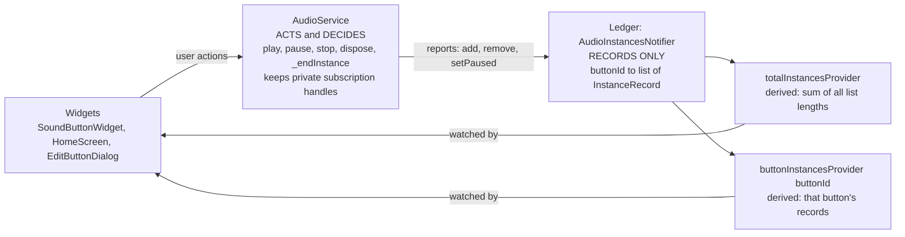
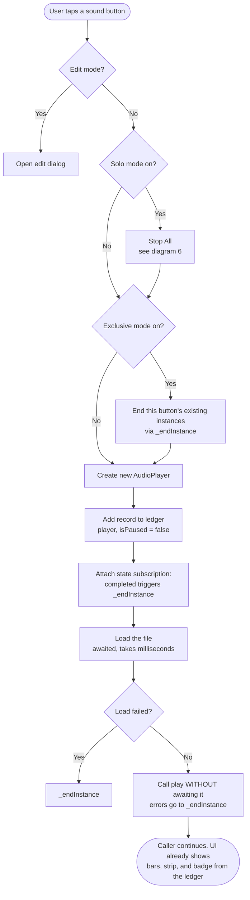
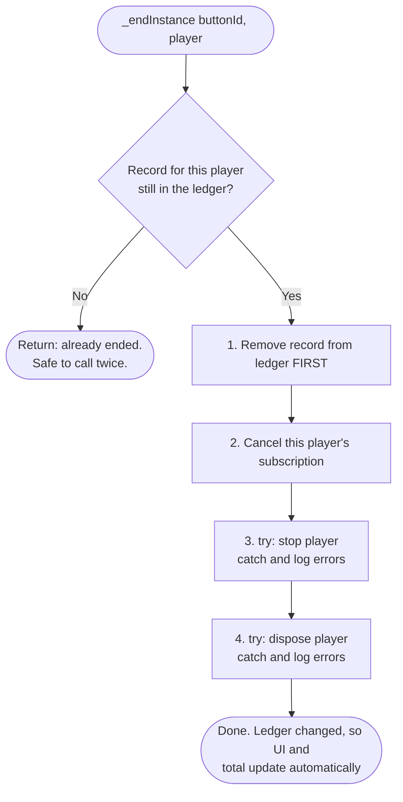
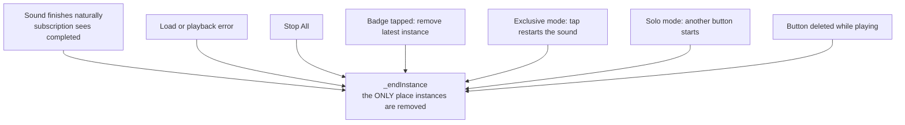
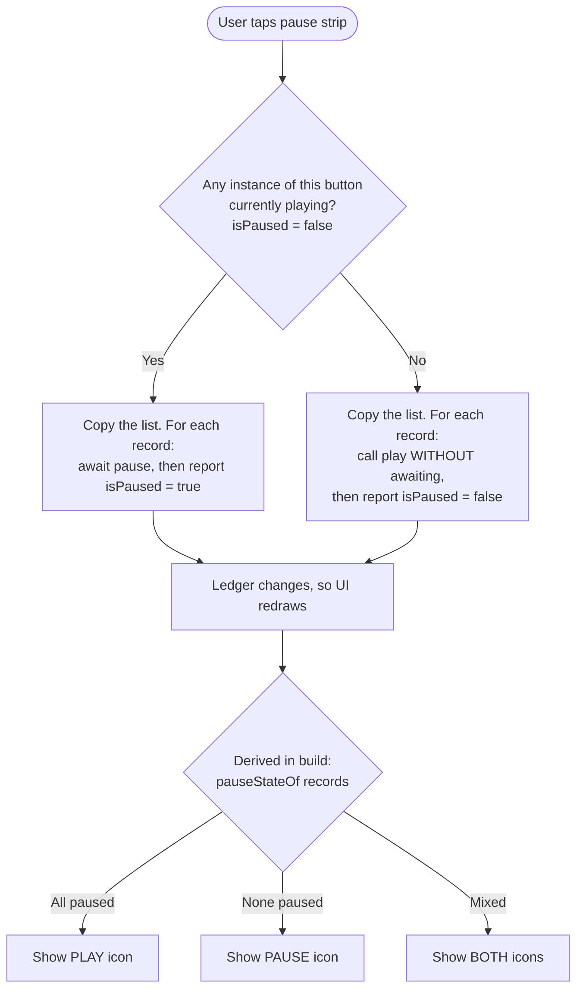
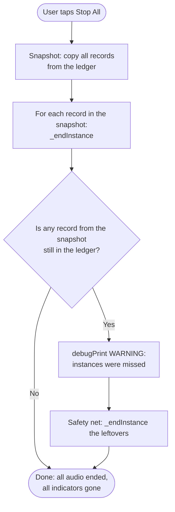
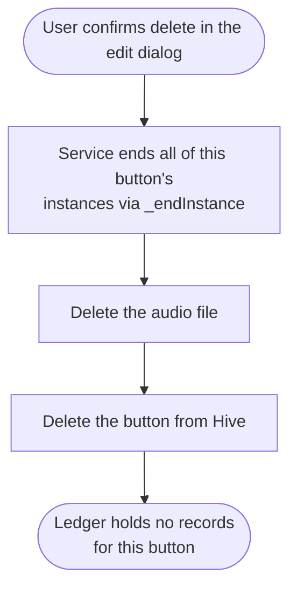
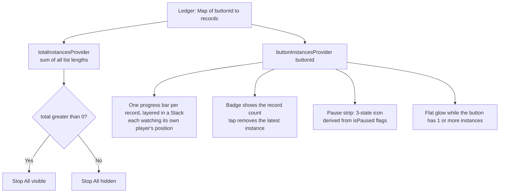

# Audio Redesign - Target Design (v0.10.2)

Design goal: **state follows reality.** The audio service is the only thing that acts
(play, pause, stop, dispose). The ledger (a Riverpod notifier) only records what the
service reports. Everything on screen is calculated from the ledger, never stored twice.

---

## Confirmed decisions

1. **Ledger.** A Riverpod notifier holds one record per instance (`InstanceRecord`: the
   player plus an `isPaused` flag), grouped by button id.
2. **Service gets the ledger passed in** when it is created (not `Ref`). The ledger
   exposes read-only getters. The ledger never calls the service.
3. **`_endInstance` lives in the service** and is the only place instances are removed.
   It is safe to call twice for the same instance.
4. **Natural finish is detected by a stored state subscription** that `_endInstance`
   cancels. We never wait on `play()` or on a `completed` event that may never arrive.
5. **The record is added at creation**, before the file loads. A failed load may flash
   briefly, which is a useful visual cue.
6. **Stop All** ends every instance (playing or paused), then verifies. The warning
   print is permanent.
7. **Pause state is derived** from the records (three states). Pressing the strip in
   the mixed state pauses all.
8. **Progress bars layer in a `Stack`** as semi-transparent white bars. Each bar watches
   its own player. Opacity is tuned after the fixes work.
9. **Glow is flat:** on whenever the button has at least one instance.
10. **Deleting a button ends its instances first.**
11. **Any loop that contains an `await` iterates over a copy** of the collection.
12. **Pause and resume helpers take a list of records**, which prepares for the planned
    universal pause/play button (see "Planned later").

## Confirmed facts (just_audio docs and Tests 1 and 2 on Android)

- `play()` completes when the sound finishes, is paused, **or** is stopped. Its return
  never means "ended".
- `stop()` leaves the player at `idle` with `playing=false` and never reaches
  `completed`. Cleanup cannot wait for `completed` after a stop.
- `idle` also appears at the start of every player's life, so it cannot be an end signal.
- `dispose()` sends the player to `idle`.
- A natural finish shows `completed` with `playing=true`.

---

## 1. Who owns what

UI never changes the ledger directly, and the ledger never calls the service. The
subscription handles are resources, not facts about what is playing, so they do not
duplicate the ledger. Only `_endInstance` touches them.

---

## 2. Starting an instance (a button tap)

Fix for Problem 1. The record exists before anything slow happens, and nothing waits
for the sound to end.

---

## 3. `_endInstance` (the one cleanup method)

The ledger record is removed first. Stopping or disposing a player can trigger more
events, and a second call finds no record and returns, so nothing is counted or
disposed twice.

---

## 4. Every exit path converges on `_endInstance`

Fix for Problems 2, 3, 5, and 6. Cleanup no longer depends on a player reaching
`completed`, so a stopped player is removed because we remove it directly.

---

## 5. Pause and resume (state derived from records)

A new instance joins with `isPaused = false`, so if the others are paused the icon
becomes mixed on its own. Pressing the strip in the mixed state pauses everything.
`play()` returns on pause, so resume must not await it inside a loop.

---

## 6. Stop All (full reset)

The check compares against the snapshot, not the whole ledger. A sound the user starts
while Stop All is still running will not trigger a false warning.

---

## 7. Deleting a button

The order matters. Instances end before the file is deleted.

---

## 8. What the UI calculates from the ledger

No `_instanceCount`, `_isPaused`, `_playerProgress`, or `_playerSubscriptions` in the
widget. Each of those was a second copy of information the ledger already has.

---

## Problems this design addresses

| Problem | Addressed by |
|---|---|
| 1. No indicators on first press | Diagram 2: record added before any waiting |
| 2. Counts and indicators mismatch | Diagrams 1 and 8: one source of truth |
| 3. Stop All never disappears | Diagrams 3 and 4: total derived, one cleanup path |
| 4. Bars stack vertically | Diagram 8: Stack instead of Column |
| 5. Progress bar lingers | Diagram 8: bars belong to records and vanish with them |
| 6. Stop All leaves indicators | Diagram 6: ends every instance, then verifies |
| 7. Pause misses new instances | Diagram 5: state derived, a new instance makes it mixed |

## Checks scheduled during the build

- **Stage 2:** tap a button and press Stop All immediately, while the file is loading.
  The load should fail harmlessly and `_endInstance` should absorb it.
- **Stage 4:** tune the bar opacity by eye with 2 to 5 instances.
- **Stage 5:** resume two or more paused instances at once and confirm they all resume.

## Planned later (not part of this fix)

- **Universal pause/play button** that works like the per-button strip but for every
  active sound. Preparation now: pause/resume helpers take a list of records, and
  `pauseStateOf(records)` is a plain function, so the global button reuses both with
  the ledger's full record list.
- Visual redesign and customization.
- Windows desktop support (needs a Windows playback plugin) and recording input device
  selection.
- Pauses initiated by the OS (a phone call, for example) can leave `isPaused` out of
  sync with reality.
- Learn the `Ref`-based service wiring (Option B) for future projects.
